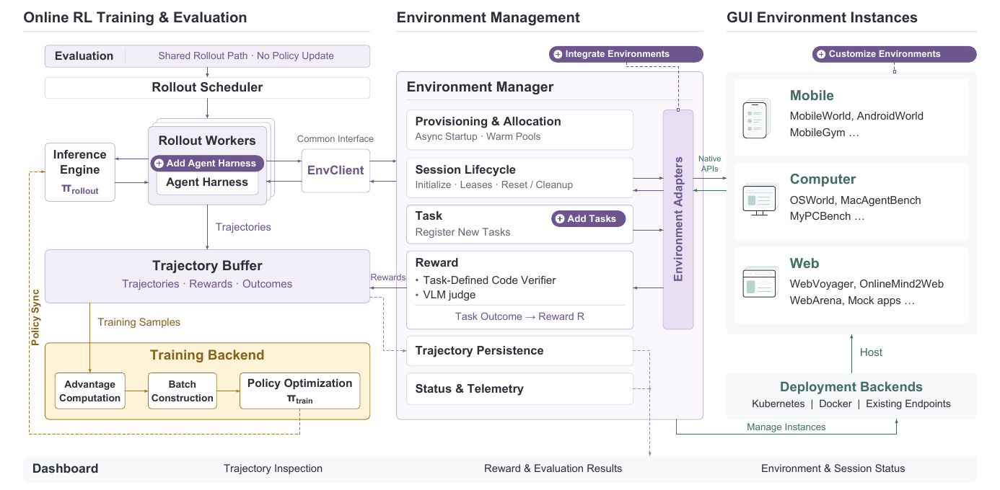
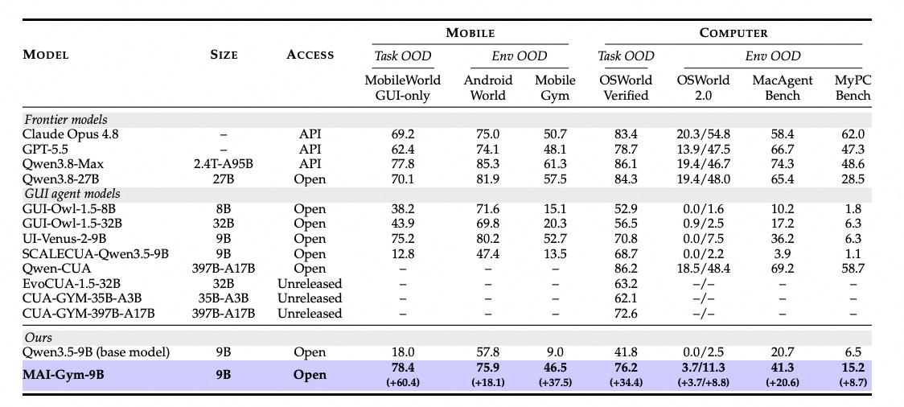

<p align="center">
  <a href="https://github.com/Tongyi-MAI/MAI-Gym/blob/main/site/assets/video/mai-gym-teaser.mp4">
    
  </a>
</p>

<div align="center">
  <h1>
    
    MAI-Gym
  </h1>
  <p><strong>An Open All-in-One Platform for GUI Agent Evaluation and RL Training across Mobile, Computer, and Web Environments</strong></p>
  <p>
    <a href="https://tongyi-mai.github.io/MAI-Gym/"></a>
    <a href="https://tongyi-mai.github.io/MAI-Gym/docs/"></a>
    <a href="https://arxiv.org/abs/2610.20939"></a>
    <a href="https://huggingface.co/Tongyi-MAI/MAI-Gym-9B"></a>
    <a href="https://tongyi-mai.github.io/MAI-Gym/#apps"></a>
    <a href="pyproject.toml"></a>
    <a href="LICENSE"></a>
  </p>

  <p>
    <a href="#-news">News</a> ·
    <a href="#-framework">Framework</a> ·
    <a href="#-supported-environments--mocked-apps">Environments</a> ·
    <a href="#-mai-gym-9b-performance">Performance</a> ·
    <a href="#-getting-started">Getting Started</a> ·
    <a href="#-documentation">Documentation</a> ·
    <a href="#-citation">Citation</a>
  </p>
</div>

**MAI-Gym** provides a unified infrastructure for evaluating GUI agents, collecting interaction trajectories, and running online reinforcement learning across mobile, desktop, and web environments—scaling cleanly from a single local emulator to **20,000+ concurrent cloud instances**.

---

## 🔥 News

- **[2026-10]** **MAI-Gym** is released with the [technical report](https://arxiv.org/abs/2610.20939), [interactive project page](https://tongyi-mai.github.io/MAI-Gym/), [42 Novel Mocked Apps](site/docs/raw/mocked-apps.md), and the [MAI-Gym-9B checkpoint](https://huggingface.co/Tongyi-MAI/MAI-Gym-9B).

---

## 🧩 Framework

<p align="center">
  
</p>

Every environment is driven through a single unified lifecycle:

```text
acquire ──▶ reset ──▶ (observe ──▶ act)* ──▶ evaluate ──▶ release
```

- **Unified Harness (Train–Eval Consistency):** Evaluation (`mai-gym eval`), trajectory collection (`mai-gym rollout`), and online RL training (`mai-gym train`) share the exact same agent harness, prompt construction, action parser, and interaction loop.
- **Unified Environment Management:** `EnvClient` standardizes allocation, observation, exact task reset, action execution, and verification while preserving each benchmark's native evaluators and action spaces.
- **Massively Scalable & Elastic:** Deploy across Kubernetes, Docker, physical devices, or remote endpoints via `mai-gym serve`. Evaluated at scales up to **20,000 concurrent environments** with warm pools, session leases, operation deadlines, and isolated verifiers.
- **Efficient Multimodal History:** Window-wise history preserves reusable prompt prefixes for KV-cache hits while bounding recent screenshots; sticky routing pins active trajectories to the inference engine holding their cache.
- **Online RL Integration:** Connects directly to the bundled [Slime](resources/slime/README.md) runtime for synchronous or asynchronous rollouts, supporting **GRPO, DAPO, GSPO, REINFORCE++, SAO, and PPO**.
- **Built-in Diagnostics & Replay:** Task-defined code verifiers and VLM judges produce rewards, while the embedded [Rust trajectory dashboard](src/dashboard-rs/README.md) links aggregate scores directly to step-by-step screenshots, model reasoning traces, and verifier outputs.

---

## 🌍 Supported Environments & Mocked Apps

MAI-Gym integrates **10 standard GUI benchmarks** alongside **Mocked Apps** (in the paper: *7 Real-World Clones* + *42 Novel Apps*; this repository bundles all **42 browser-based Novel Apps** with 837 verified tasks and reference oracle trajectories).

| Domain | Benchmark / Suite | CLI ID (`--benchmarks`) | Setup & Preparation Guide |
| :--- | :--- | :--- | :--- |
| **Mobile** | MobileWorld | `mobileworld` | [skills/envs/mobileworld.md](skills/envs/mobileworld.md) |
| **Mobile** | AndroidWorld | `androidworld` | [skills/envs/androidworld.md](skills/envs/androidworld.md) |
| **Mobile** | MobileGym | `mobilegym` | [skills/envs/mobilegym.md](skills/envs/mobilegym.md) |
| **Computer** | OSWorld-Verified | `osworld-verified` | [skills/envs/osworld.md](skills/envs/osworld.md) |
| **Computer** | OSWorld 2.0 | `osworld-2` | [skills/envs/osworld_2.md](skills/envs/osworld_2.md) |
| **Computer** | MacAgentBench | `macagentbench` | [skills/envs/macagentbench.md](skills/envs/macagentbench.md) |
| **Computer** | MyPCBench | `mypcbench` | [skills/envs/mypcbench.md](skills/envs/mypcbench.md) |
| **Web** | WebVoyager | `webvoyager` | [skills/envs/webvoyager.md](skills/envs/webvoyager.md) |
| **Web** | Online-Mind2Web | `onlinemind2web` | [skills/envs/onlinemind2web.md](skills/envs/onlinemind2web.md) |
| **Web** | WebArena | `webarena` | [skills/envs/webarena.md](skills/envs/webarena.md) |
| **Web** | Mocked Apps *(42 Novel Apps)* | `mocked-apps` | [Run with the CLI](site/docs/raw/mocked-apps.md#evaluate-a-task) · [Live Gallery](https://tongyi-mai.github.io/MAI-Gym/#apps) |

> [!NOTE]
> For immutable profile locks, single-task environment validation protocols, or multi-node Kubernetes fleets, see [Benchmark Setup](https://tongyi-mai.github.io/MAI-Gym/docs/environments.html) and the [Kubernetes Fleet Guide](https://tongyi-mai.github.io/MAI-Gym/docs/kubernetes.html).

---

## 📊 MAI-Gym-9B Performance

Initialized from **Qwen3.5-9B** with a mixed mobile–computer SFT warm-up followed by joint online GUI reinforcement learning, **[MAI-Gym-9B](https://huggingface.co/Tongyi-MAI/MAI-Gym-9B)** achieves state-of-the-art performance among open GUI agents under 10B parameters across mobile and desktop benchmarks:

<p align="center">
  
</p>

See [MAI-Gym-9B](https://tongyi-mai.github.io/MAI-Gym/docs/mai-gym-9b.html) and the [technical report](https://arxiv.org/abs/2610.20939) for the complete benchmark breakdown (including OSWorld 2.0) and clone-to-real transfer results (28.8% → 48.1% on a physical phone).

---

<a name="quickstart"></a>

## 🚀 Getting Started

> [!TIP]
> **Using a Coding Agent (Claude Code, Codex, Cursor)?**
> Agent-readable setup guides live under [`skills/`](skills/README.md). Open this repository in your agent and prompt:
> *"Follow `skills/README.md` to prepare MobileWorld for evaluation. Show me the healthy device and the registered task ID before running the trial."*

### 1. Install the CLI

Requires **Python 3.12+** and [`uv`](https://docs.astral.sh/uv/getting-started/installation/) (`curl -LsSf https://astral.sh/uv/install.sh | sh` on Linux/macOS).

```bash
git clone https://github.com/Tongyi-MAI/MAI-Gym.git
cd MAI-Gym
uv sync --locked --python 3.12
uv run mai-gym --help
```

### 2. Start a MobileWorld Environment

> [!NOTE]
> Deploying across multiple nodes? Follow the [Kubernetes Fleet Guide](https://tongyi-mai.github.io/MAI-Gym/docs/kubernetes.html) and use the manager's URL in Step 3.

On a Linux `x86_64` host with Docker and KVM enabled, launch a single Android emulator backend (skip to the `curl` checks if you already have a running backend):

```bash
MW_SRC="$HOME/MobileWorld"
git clone --depth 1 https://github.com/Tongyi-MAI/MobileWorld.git "$MW_SRC"
cp -i "$MW_SRC/.env.example" "$MW_SRC/.env"
uv run --directory "$HOME" --project "$MW_SRC" --python 3.12 mw env run --count 1 \
  --name-prefix mai-gym-quickstart --backend-start-port 6800 \
  --image ghcr.io/tongyi-mai/mobile_world:v1 --env-file "$MW_SRC/.env"
```

Once booted, initialize the emulator and verify that `SetAlarmTask` is registered:

```bash
MOBILEWORLD_URL=http://127.0.0.1:6800
curl -fsS "$MOBILEWORLD_URL/init?device=emulator-5554"
curl -fsS "$MOBILEWORLD_URL/health"
curl -fsS "$MOBILEWORLD_URL/task/list" | uv run python -m json.tool
```

### 3. Evaluate a GUI Agent

Download the `MAI-Gym-9B` checkpoint and copy the sample configurations into a working directory:

```bash
EVAL_DIR="$HOME/mai-gym-eval"
DATA_DIR="$HOME/mai-gym-data"
mkdir -p "$EVAL_DIR" "$DATA_DIR"

uvx --from huggingface-hub hf download Tongyi-MAI/MAI-Gym-9B --local-dir "$DATA_DIR/hf-model"
cp -i configs/eval.yaml configs/mobileworld.yaml "$EVAL_DIR/"
```

Configure `$EVAL_DIR/eval.yaml` to run `SetAlarmTask`:

```yaml
model:
  name: Tongyi-MAI/MAI-Gym-9B
benchmarks:
  mobileworld:
    manager_config: mobileworld.yaml
    num_envs: 1
    tasks: [SetAlarmTask]
```

Ensure `$EVAL_DIR/mobileworld.yaml` points to your backend URL (`http://127.0.0.1:6800`):

```yaml
devices:
  - name: local-mobileworld
    env_type: mobileworld
    connection:
      attach:
        backends:
          - url: http://127.0.0.1:6800
manager:
  port: 8090
```

Run a 1-trial evaluation (the CLI automatically launches SGLang for local Hugging Face checkpoints):

```bash
uv run --with sglang mai-gym eval --config "$EVAL_DIR/eval.yaml" \
  --model "$DATA_DIR/hf-model" --benchmarks mobileworld --trials 1
```

<details>
<summary><strong>Using an existing OpenAI-compatible API endpoint instead of local SGLang?</strong></summary>

Skip the checkpoint download and pass your API base URL and model ID directly:

```bash
export OPENAI_API_KEY="your-api-key" # if required
uv run mai-gym eval --config "$EVAL_DIR/eval.yaml" \
  --model http://127.0.0.1:8000/v1 --model-name Tongyi-MAI/MAI-Gym-9B \
  --benchmarks mobileworld --trials 1
```

</details>

Check the printed `results.json` path (`success_rate: 1.0` and `unscored_trials: 0` indicate native success). See the [Evaluation Guide](https://tongyi-mai.github.io/MAI-Gym/docs/evaluation.html) to replay trajectories in the dashboard or evaluate across multiple benchmarks simultaneously.

<a name="train"></a>

### 4. Train a GUI Agent with Online RL (Optional)

This quickstart trains the agent with GRPO to open the Android Settings app (`com.android.settings`) using [`examples/mobileworld/open_settings.py`](examples/mobileworld/open_settings.py).

**Step 4a: Register the custom task in your MobileWorld container**

> [!TIP]
> MAI-Gym also provides a customized MobileWorld Docker image with **live task registration**: send a multipart `POST /task/register` request with a `set_id` and task ZIP in the `package` field to register tasks immediately without restarting.

For the standard image used in Step 2, copy the task into the container and restart it:

```bash
MW_CONTAINER=mai-gym-quickstart_0
MOBILEWORLD_URL=http://127.0.0.1:6800

docker cp examples/mobileworld/open_settings.py \
  "$MW_CONTAINER:/app/service/src/mobile_world/tasks/definitions/quickstart_open_settings.py"
docker restart "$MW_CONTAINER"
curl -fsS --retry 60 --retry-all-errors --retry-delay 2 "$MOBILEWORLD_URL/init?device=emulator-5554"
curl -fsS "$MOBILEWORLD_URL/task/goal?task_name=QuickstartOpenSettings"
```

**Step 4b: Start a persistent environment manager**

In a separate terminal, keep the MAI-Gym environment manager running on port `8090`:

```bash
uv run mai-gym serve --config "$HOME/mai-gym-eval/mobileworld.yaml"
```

**Step 4c: Prepare the training task pool and configuration**

Using `$HOME/mai-gym-data` (containing `hf-model/` from Step 3), create a single-task JSONL pool and copy the quickstart training preset:

```bash
TRAIN_DIR="$HOME/mai-gym-data"
mkdir -p "$TRAIN_DIR/runs"
cp -i configs/train-quickstart.yaml "$TRAIN_DIR/train.yaml"

printf '%s\n' '{"prompt":"Open the Android Settings app and leave it in the foreground.","label":"","metadata":{"task_id":"QuickstartOpenSettings","env_type":"mobileworld"}}' \
  > "$TRAIN_DIR/mobileworld.jsonl"
```

> [!NOTE]
> If your manager runs on a different machine than your GPU training node, update `tasks[0].manager_url` in `$TRAIN_DIR/train.yaml` to the manager's reachable address.

**Step 4d: Launch training inside the Slime container**

On a Linux host with 4 NVIDIA GPUs, start the prebuilt Slime runtime container:

```bash
docker run --rm -it --gpus all --ipc=host --network=host \
  -v "$PWD:/workspace/MAI-Gym" -w /workspace/MAI-Gym -e MAI_GYM_ROOT=/workspace/MAI-Gym \
  -v "$TRAIN_DIR:/data:ro" -v "$TRAIN_DIR/runs:/runs" \
  ghcr.io/tongyi-mai/mai_gym_slime:v1 bash
```

Inside the container, install the CLI in editable mode, start a local Ray head, and run training:

```bash
python -m pip install --no-deps -e .
ray start --head
mai-gym train --config /data/train.yaml
```

Once the first round completes, the exported Hugging Face checkpoint is saved on the host under `$TRAIN_DIR/runs/first-run/hf/`. For multi-node setups, custom GPU allocations, and checkpoint resumption, see the [RL Training Guide](https://tongyi-mai.github.io/MAI-Gym/docs/training.html).

---

## 📚 Documentation

Full interactive documentation is hosted at **[tongyi-mai.github.io/MAI-Gym/docs](https://tongyi-mai.github.io/MAI-Gym/docs/)**:

| Topic | Description | Link |
| :--- | :--- | :--- |
| **Quickstart** | Install the CLI, run local Mocked Apps (`--benchmarks mocked-apps`), or run MobileWorld eval & RL | [Quickstart](https://tongyi-mai.github.io/MAI-Gym/docs/) |
| **Platform & Core Concepts** | Architecture, `EnvClient` lifecycle, executable tasks, Hybrid Action Space (GUI + CLI), and the 4-stage loop | [Platform & Core Concepts](https://tongyi-mai.github.io/MAI-Gym/docs/concepts.html) |
| **MAI-Gym-9B** | Open 9B GUI agent benchmark results, clone-to-real transfer highlights, and evaluation setup | [MAI-Gym-9B](https://tongyi-mai.github.io/MAI-Gym/docs/mai-gym-9b.html) |
| **Trajectory Dashboard** | Visual Control Room tour, Rust/SQLite server, indexer, and HTTP diagnosis API | [Dashboard](https://tongyi-mai.github.io/MAI-Gym/docs/dashboard.html) · [`src/dashboard-rs`](src/dashboard-rs/README.md) |
| **Evaluation Guide** | Single- and multi-benchmark evaluation, native metrics, `pass@N`, and local SGLang serving | [Evaluation](https://tongyi-mai.github.io/MAI-Gym/docs/evaluation.html) |
| **RL Training Guide** | Policy-adaptive sampling, window-wise packing, Slime/Ray setup, and checkpoint resumption | [Online RL Training](https://tongyi-mai.github.io/MAI-Gym/docs/training.html) |
| **Rollout CLI** | Direct trajectory collection, agent debugging, and retry controls | [Rollout CLI](https://tongyi-mai.github.io/MAI-Gym/docs/rollout.html) |
| **Kubernetes Fleets** | Multi-node MobileWorld pools, `SandboxSet` scaling, and fleet autoscaling | [Kubernetes Fleets](https://tongyi-mai.github.io/MAI-Gym/docs/kubernetes.html) |
| **Benchmarks & Environments** | Mobile, Computer, and Web benchmark overviews plus coding-agent setup skills | [Benchmarks](https://tongyi-mai.github.io/MAI-Gym/docs/environments.html) · [`skills/envs.md`](skills/envs.md) |
| **Mocked Apps** | Resettable Real-World Clones & 42 bundled Novel Apps (837 tasks) runnable via `--benchmarks mocked-apps` | [Mocked Apps](https://tongyi-mai.github.io/MAI-Gym/docs/mocked-apps.html) · [`resources/novel-apps`](resources/novel-apps/) |
| **Customization** | 4 extension points, 5-operation adapter contract, coding-agent setup, repo layout, and checks | [Extending](https://tongyi-mai.github.io/MAI-Gym/docs/extending.html) · [Development](https://tongyi-mai.github.io/MAI-Gym/docs/development.html) |

---

## 📄 Citation

If you find MAI-Gym, Mocked Apps, or MAI-Gym-9B useful in your research, please cite our paper:

```bibtex
@article{maigym2026,
  title   = {{MAI-Gym}: An Open All-in-One Platform for GUI Agent Evaluation
             and RL Training across Mobile and Computer Environments},
  author  = {Panrong Tong and Quyu Kong and Pengxiang Li and Tianyu Xia and
             Hanzhang Zhou and Lei Wang and Chenglin Cai and Long Li and Long Chen and
             Jianan Zhang and Zhengwen Zeng and Xu Zhang and Gongjie Zhang and
             Yue Wang and Steven Hoi},
  journal = {arXiv preprint arXiv:2610.20939},
  year    = {2026},
  url     = {https://arxiv.org/abs/2610.20939}
}
```

---

## 📜 License

MAI-Gym's framework, RL adapters, dashboard, documentation, and Mocked Apps (42 Novel Apps) are released under the [MIT License](LICENSE). Third-party components (such as the bundled [Slime](resources/slime/LICENSE) runtime under Apache 2.0) retain their respective licenses—see [Licensing & Notices](https://tongyi-mai.github.io/MAI-Gym/docs/licensing.html) for full details.
