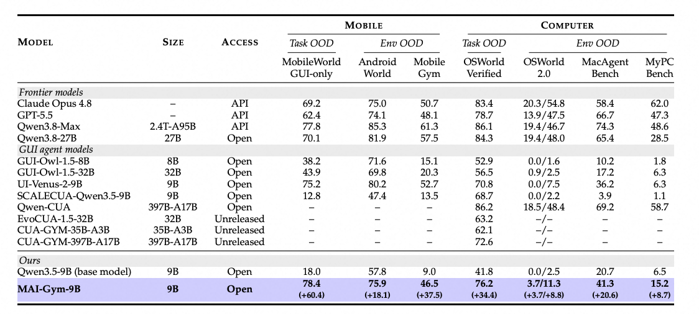

<p align="center">
  <a href="https://github.com/Tongyi-MAI/MAI-Gym/blob/main/site/assets/video/mai-gym-teaser.mp4"></a>
</p>

<div align="center">
  <h1> MAI-Gym</h1>
  <p><strong>An Open All-in-One Platform for GUI Agent Evaluation and RL Training across Mobile and Computer Environments</strong></p>
  <p>
    <a href="https://tongyi-mai.github.io/MAI-Gym/"></a>
    <a href="https://arxiv.org/abs/2610.20939"></a>
    <a href="https://huggingface.co/Tongyi-MAI/MAI-Gym-9B"></a>
  </p>

  [News](#news) · [Framework](#framework) · [MAI-GYM-9B Performance](#mai-gym-9b-performance) · [Citation](#citation)
</div>

MAI-Gym provides a shared infrastructure for evaluating GUI agents, collecting trajectories, and running online reinforcement learning across mobile, computer, and web environments. Framework source code will be released soon.

<a name="news"></a>

## 🔥 News

<!-- Add new entries at the top, newest first. -->
- **[2026-10]** 🚀 MAI-Gym is released with the [paper](https://arxiv.org/abs/2610.20939), [project website](https://tongyi-mai.github.io/MAI-Gym/), and [MAI-Gym-9B model weights](https://huggingface.co/Tongyi-MAI/MAI-Gym-9B). Framework source code is coming soon.

<a name="framework"></a>

## 🧩 Framework

<p align="center">
  
</p>

- **One harness and one rollout path.** Evaluation, data collection, and RL training use the same agent harness, prompt construction, action parser, and interaction loop, preventing implementation drift between training and evaluation.
- **Unified environment management.** `EnvClient` exposes a common interface for instance allocation, observation, task reset, action execution, and evaluation. Environment adapters preserve each benchmark's native initialization, actions, and verifiers.
- **Cross-platform deployment.** The same manager serves mobile, computer, and web instances hosted on Kubernetes, Docker, physical devices, or existing endpoints. MAI-Gym has been tested with up to 20,000 concurrent environments.
- **Reliable, elastic rollouts.** Asynchronous provisioning, warm pools, exact task resets, session leases, idempotent actions, operation deadlines, and isolated verifiers contain infrastructure failures and keep them out of the training signal.
- **Efficient multimodal history.** Window-wise history preserves reusable prompt prefixes for KV-cache reuse while bounding recent screenshots. Sticky routing keeps each trajectory on the inference engine that holds its cache.
- **Verifiable tasks and diagnostics.** Task-defined code verifiers and VLM judges produce rewards; persisted trajectories and the dashboard connect aggregate scores to screenshots, model outputs, actions, verifier results, and environment status.
- **Extensible task and environment synthesis.** MAI-Gym supports resettable mocked apps, coherent cross-app worlds, execution-validated tasks, and four extension points: agent harnesses, tasks, environment adapters, and environment specifications.
- **Online RL integration.** The trajectory buffer feeds synchronous or asynchronous training backends, with support for GRPO, DAPO, GSPO, REINFORCE++, SAO, and PPO through Slime.

<a name="mai-gym-9b-performance"></a>

## 📊 MAI-GYM-9B Performance

<p align="center">
  
</p>

<a name="citation"></a>

## 📄 Citation

```bibtex
@article{maigym2026,
  title   = {{MAI-Gym}: An Open All-in-One Platform for GUI Agent Evaluation
             and RL Training across Mobile and Computer Environments},
  author  = {Panrong Tong and Quyu Kong and Pengxiang Li and Tianyu Xia and
             Hanzhang Zhou and Lei Wang and Chenglin Cai and Long Li and Long Chen and
             Jianan Zhang and Zhengwen Zeng and Xu Zhang and Gongjie Zhang and
             Yue Wang and Steven Hoi},
  journal = {arXiv preprint arXiv:2610.20939},
  year    = {2026},
  url     = {https://arxiv.org/abs/2610.20939}
}
```
