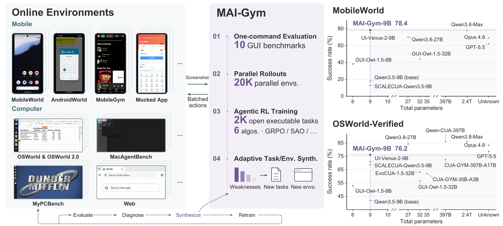
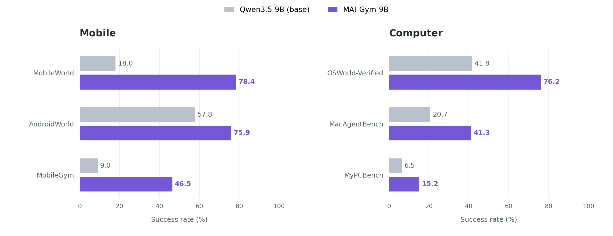

<div align="center">
  
  <h1>MAI-Gym</h1>
  <p><strong>An Open All-in-One Platform for GUI Agent Evaluation and RL Training<br>across Mobile and Computer Environments</strong></p>
  <p>Evaluate agents. Build verifiable worlds. Train across devices.</p>
  <p>
    <a href="https://tongyi-mai.github.io/MAI-Gym/"></a>
    <a href="https://arxiv.org/abs/2610.20939"></a>
    <a href="https://huggingface.co/Tongyi-MAI/MAI-Gym-9B"></a>
  </p>
  <p><strong>MAI-UI Team · Alibaba Group</strong></p>
</div>

> [!IMPORTANT]
> **Model weights are available.** Download **MAI-Gym-9B** from [Hugging Face](https://huggingface.co/Tongyi-MAI/MAI-Gym-9B), explore the [interactive demos](https://tongyi-mai.github.io/MAI-Gym/), and read the [paper](https://arxiv.org/abs/2610.20939). **Source code is coming soon.**

**MAI-Gym** brings evaluation, trajectory collection, and online reinforcement learning into one platform for **mobile, computer, and web agents**. The same interaction and verification pipeline carries an agent from benchmark evaluation to training at scale.

<p align="center">
  <a href="https://arxiv.org/abs/2610.20939"></a>
</p>
<p align="center"><sub>One platform connects GUI environments, verifiable tasks, and reinforcement learning. Click the figure to read the paper.</sub></p>

## One platform. Three workloads. Every GUI domain.

MAI-Gym uses a shared rollout pipeline for evaluation, data collection, and online RL. Environment adapters preserve each benchmark's native actions, reset procedures, and task verifiers, while the platform handles the interaction lifecycle and records inspectable trajectories.

| **Evaluate** | **Collect** | **Train** |
| --- | --- | --- |
| Run agents across **10 GUI benchmarks** through a common interface. | Record screenshots, model outputs, actions, and verifier results for diagnosis and reuse. | Learn from environment feedback through synchronous or asynchronous online rollouts. |

| Domain | Environments |
| --- | --- |
| **Mobile** | MobileWorld, AndroidWorld, MobileGym, and mocked mobile apps |
| **Computer** | OSWorld / OSWorld-Verified, OSWorld 2.0, MacAgentBench, and MyPCBench |
| **Web** | WebArena, WebVoyager, and locally served applications |

The infrastructure supports **20,000 parallel environments**, with environment provisioning, warm pools, session management, and screenshot storage supporting large-scale interaction. Online RL supports **GRPO, DAPO, GSPO, REINFORCE++, SAO, and PPO** through integration with Slime.

## Turn failures into new training worlds

GUI learning needs tasks whose initial state can be restored and whose outcomes can be checked. MAI-Gym's adaptive synthesis workflow builds coherent application worlds, creates task instructions and verifiers, and validates them through execution. Diagnosis of agent trajectories guides the next round of applications and tasks.

| **49 resettable mocked apps** | **42 novel apps** | **2,000 verified tasks** |
| :---: | :---: | :---: |
| Repeatable environments for agent interaction | Broader application coverage for training | Tasks with execution-validated verifiers |

<p align="center"><strong>Evaluate → Diagnose → Synthesize → Retrain</strong></p>

Explore the [novel apps and tasks](https://tongyi-mai.github.io/MAI-Gym/#apps): interact with the apps, try a task, check completion, and watch a reference solution.

## One 9B agent for mobile and computer use

Trained from **Qwen3.5-9B** with mixed-domain GUI reinforcement learning, **MAI-Gym-9B** reaches **78.4% on MobileWorld** and **76.2% on OSWorld-Verified**, leading open GUI agents under 10B parameters on these benchmarks in our [paper](https://arxiv.org/abs/2610.20939).

<p align="center">
  <a href="docs/assets/benchmark-results.png"></a>
</p>
<p align="center"><sub>Success rate (%). The same 9B policy improves across all six benchmarks shown. Results from the <a href="https://tongyi-mai.github.io/MAI-Gym/#results">project evaluation</a>.</sub></p>

<details>
<summary><strong>Full benchmark results</strong></summary>

Gains are absolute percentage points over Qwen3.5-9B.

| Domain | Benchmark | Qwen3.5-9B (base) | MAI-Gym-9B | Gain |
| --- | --- | ---: | ---: | ---: |
| Mobile | MobileWorld (GUI-only) | 18.0 | **78.4** | +60.4 |
| Mobile | AndroidWorld | 57.8 | **75.9** | +18.1 |
| Mobile | MobileGym | 9.0 | **46.5** | +37.5 |
| Computer | OSWorld-Verified | 41.8 | **76.2** | +34.4 |
| Computer | MacAgentBench | 20.7 | **41.3** | +20.6 |
| Computer | MyPCBench | 6.5 | **15.2** | +8.7 |

See the [paper](https://arxiv.org/abs/2610.20939) for evaluation protocols and full results, including OSWorld 2.0.

</details>

## From mocked apps to real devices

Training in a mocked Railway12306 app transfers to the real app on a physical phone: task success improves from **28.8% to 48.1%**, a gain of **19.3 percentage points**. This connects resettable training environments with the interfaces agents encounter on real devices.

| **Explore the apps** | **Compare simulation and reality** |
| --- | --- |
| [Try interactive tasks and watch reference solutions →](https://tongyi-mai.github.io/MAI-Gym/#apps) | [See real-versus-mocked app comparisons →](https://tongyi-mai.github.io/MAI-Gym/#mock-vs-real) |

## Citation

If you use MAI-Gym in your research, please cite our [paper](https://arxiv.org/abs/2610.20939):

```bibtex
@article{maigym2026,
  title   = {MAI-Gym: An Open All-in-One Platform for GUI Agent Evaluation
             and RL Training across Mobile and Computer Environments},
  author  = {Panrong Tong and Quyu Kong and Pengxiang Li and Tianyu Xia and
             Hanzhang Zhou and Lei Wang and Chenglin Cai and Long Li and Long Chen and
             Jianan Zhang and Zhengwen Zeng and Xu Zhang and Gongjie Zhang and
             Yue Wang and Steven Hoi},
  journal = {arXiv preprint arXiv:2610.20939},
  year    = {2026},
  url     = {https://arxiv.org/abs/2610.20939}
}
```
