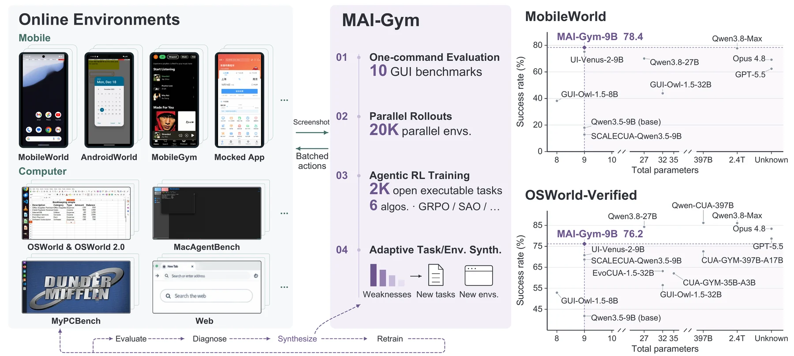
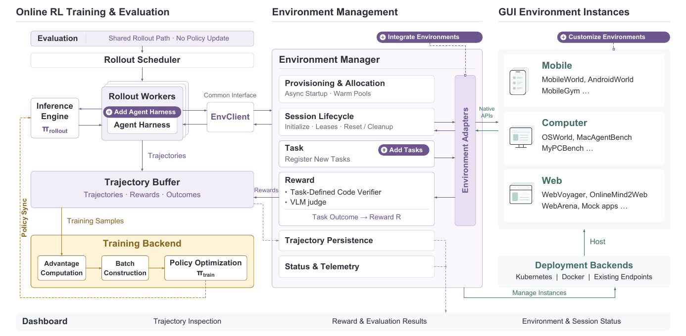

# Platform & Core Concepts

[Home](../../../README.md) · [Quickstart](index.md) · **Platform & Core Concepts** · [MAI-Gym-9B](mai-gym-9b.md) · [Evaluation](evaluation.md) · [Training](training.md)

MAI-Gym combines a unified cross-platform execution stack with a single executable task abstraction, a **Hybrid Action Space (GUI + CLI)**, and one shared rollout pipeline that keeps evaluation, trajectory collection, and online RL training consistent. For the formal treatment and empirical analysis, see the [technical report](https://arxiv.org/abs/2610.20939).

<p align="center">
  
</p>

---

## Platform Architecture

<p align="center">
  
</p>

Watch the [full project demo](../../assets/video/mai-gym-demo.mp4) or explore the [interactive project website](../../index.html).

### Core Platform Capabilities

- **One Harness, One Rollout Path:** Evaluation (`mai-gym eval`), trajectory collection (`mai-gym rollout`), and online RL training (`mai-gym train`) execute the exact same agent harness, prompt builder, action parser, and interaction loop—eliminating train–eval drift.
- **Unified Environment Management:** `EnvClient` exposes a consistent lifecycle for allocation, observation, exact task reset, action execution, and verification while adapters preserve each benchmark's native initialization, action space, and evaluators ([Extending MAI-Gym](extending.md#environment-contract--responsibilities)).
- **Cross-Platform Execution Stack (up to 20,000 Concurrent Envs):** A single manager serves mobile, computer, and web instances across Kubernetes, Docker, physical devices, or remote endpoints:
  - **Mobile:** Containerized Android via ReDroid (avoiding nested virtualization on container clusters) with golden `/data` snapshot resets, plus local Docker/KVM emulators.
  - **Computer:** Isolated desktop VMs with strict guest-readiness checks, per-instance service ports and artifact caches, and automatic container recovery.
  - **Web:** Headless Chromium hosting live websites, self-hosted benchmark suites, and deterministic browser **Mocked Apps**.
- **Fault-Isolated, Elastic Rollouts:** Asynchronous provisioning, warm pools, session leases, idempotent action IDs, operation deadlines, isolated verifier process groups, and object-storage (`oss`) screenshot transport keep infrastructure faults separate from the training signal.
- **Efficient Multimodal History:** Window-wise history (`K = 10, O = 2`) preserves reusable prompt prefixes for KV-cache hits while bounding active screenshots; sticky routing pins each trajectory to the inference engine holding its cache.
- **Verifiable Rewards & Visual Diagnostics:** Programmatic state verifiers and VLM judges produce rewards, while the embedded [Rust Trajectory Dashboard](../../../src/dashboard-rs/README.md) and its HTTP diagnosis API connect aggregate scores directly to live fleets, screenshots, model reasoning traces, and verifier outputs.
- **Online RL Integration:** Feeds synchronous or asynchronous rollout trajectories directly into the bundled [Slime](../../../resources/slime/README.md) runtime (Megatron-LM + SGLang), supporting **GRPO, DAPO, GSPO, REINFORCE++, SAO, and PPO** ([Online RL Training](training.md)).

---

## The Four-Stage Improvement Loop

MAI-Gym is structured around a closed improvement cycle for GUI agents:

1. **Evaluate** — Run one command (`mai-gym eval`) across mobile, computer, and web benchmarks using the exact training harness ([Evaluation Guide](evaluation.md)).
2. **Diagnose** — Inspect fleet health, benchmark matrices, and step-by-step screenshots in the [Trajectory Dashboard](../../../src/dashboard-rs/README.md), or query its [HTTP diagnosis API](../../../src/dashboard-rs/README.md#http-diagnosis-api) with coding agents for automated failure analysis.
3. **Synthesize** — Construct resettable **Mocked Apps** ([Mocked Apps](mocked-apps.md): *Real-World Clones* and *Novel Apps*), coherent cross-app initial states, and execution-validated tasks targeting weak capabilities (see the [technical report](https://arxiv.org/abs/2610.20939)).
4. **Retrain** — Launch joint multi-domain online RL (`mai-gym train`) with policy-adaptive task sampling and window-wise history packing ([Online RL Training](training.md)).

---

## Executable Tasks & Verification

An **environment** `E` is an interactive software system such as an Android container, a desktop virtual machine, or a browser application. An **executable task** is a four-tuple:

```text
x = (E, s₀, g, V)
```

| Component | Definition |
| :--- | :--- |
| **Environment** (`E`) | Target execution runtime (mobile, computer, or web) exposed behind the uniform `EnvClient` interface. |
| **Initial State** (`s₀`) | Reproducible application records, workspace files, accounts, and system settings loaded before step 1. Each episode runs in an isolated instance reset to `s₀`. |
| **Instruction** (`g`) | Natural-language task goal grounded in the environment state. |
| **Verifier** (`V`) | Programmatic state verifier and/or VLM trajectory judge evaluating the final state `s_T` (and optionally the trajectory `τ`). |

### Partial Credit vs. Binary Success

Task requirements are represented as binary criteria `b_j ∈ {0, 1}` with positive weights `w_j > 0` and a mandatory subset `C`:

- **Partial reward (`r ∈ [0, 1]`):** Weighted average of satisfied criteria, `r = (∑ w_j · b_j) / (∑ w_j)`.
- **Task success (`S ∈ {0, 1}`):** Binary indicator `S = ∏_{j ∈ C} b_j` requiring every mandatory criterion to pass.

Benchmarks such as OSWorld 2.0, MobileGym, and Mocked Apps (`mocked-apps`) report both binary full success and weighted partial scores.

---

<a name="one-harness-one-rollout-path"></a>
<a name="shared-environment-interface"></a>

## Shared Rollout Path & `EnvClient` Lifecycle

The same model checkpoint can produce noticeably different benchmark scores under different harnesses—for example, if evaluation retains 10 screenshots while training retains 5, or if coordinate scaling and action parsing diverge. MAI-Gym prevents train–eval drift by routing all three workloads through **one shared agent harness and rollout path**:

```text
Rollout Scheduler ──▶ Rollout Worker ──▶ EnvClient ──▶ Environment Manager ──▶ Mobile / Computer / Web
                            │
                            ▼
                  Agent Harness + Inference Engine (SGLang / OpenAI API)
                            │
                            ▼
                    Trajectory Buffer
           ┌────────────────┼────────────────┐
           ▼                ▼                ▼
      Evaluation     Data Collection    Online RL Training
    (mai-gym eval)  (mai-gym rollout)    (mai-gym train)
```

Every workload drives every environment through the exact same `EnvClient` lifecycle:

```text
acquire ──▶ reset ──▶ (observe ──▶ act)* ──▶ evaluate ──▶ release
```

| Stage | Responsibility |
| :--- | :--- |
| `acquire` | Lease an isolated environment session from the manager (local, Docker, SSH, or Kubernetes warm pool). |
| `reset` | Restore exact initial task state (`s₀`) and register task-specific preconditions. |
| `observe` / `act` | Capture screenshots (and optional CLI command output), parse batched actions, and execute them idempotently with deadlines. |
| `evaluate` | Run the benchmark's native programmatic verifier and/or VLM judge in isolation to produce rewards. |
| `release` | Return the session to the warm pool (or recycle unhealthy instances) and persist full trajectory artifacts. |

For the 5-operation adapter contract (`reqEnvs`, `observe`, `reset`, `step`, `eval`) and responsibility matrix, see [Extending MAI-Gym](extending.md#environment-contract--responsibilities).

### Supported Environment Domains

| Domain | Supported Environments | Guide |
| :--- | :--- | :--- |
| **Mobile** | MobileWorld, AndroidWorld, MobileGym, Mocked Apps (*Real-World Clones*) | [Mobile Benchmarks](envs/mobile.md) |
| **Computer** | OSWorld-Verified, OSWorld 2.0, MacAgentBench, MyPCBench | [Computer Benchmarks](envs/computer.md) |
| **Web** | WebVoyager, Online-Mind2Web, WebArena, Mocked Apps (`mocked-apps`) | [Web Benchmarks](envs/web.md) · [Mocked Apps](mocked-apps.md) |

---

<a name="hybrid-action-space"></a>

## Hybrid Action Space (GUI + CLI)

MAI-Gym defines a **Hybrid Action Space** that combines coordinate-based GUI interaction with direct command-line (`<bash>`) execution, tool/API calls, user clarification, and explicit task termination:

- **Computer environments (Hybrid GUI + CLI):** On each turn, the agent dynamically chooses between graphical `pyautogui` actions and raw `<bash>` shell commands—using CLI execution when scripting, file manipulation, or inspection is faster and more reliable than clicking, and GUI actions for visual applications.
- **Mobile & Web environments (GUI):** Agents operate through coordinate-based touch/pointer GUI actions (plus API and flow-control actions) on the exact same harness.

A single **step** corresponds to one model decision and may emit an **ordered batch** of actions (e.g., clicking a field, typing text, and pressing a shortcut in one turn). When a later step depends on shell output, the agent emits the `<bash>` block and inspects stdout/stderr on the next turn; failed CLI commands return their error text as observation feedback rather than aborting the episode. Step budgets and history windows count decision steps.

| Category | Action | Definition |
| :--- | :--- | :--- |
| **GUI** | `click` | Clicks at normalized screen coordinates `(x, y)` (plus `right_click` / `triple_click` on desktop). |
| **GUI** | `double_click` | Double-clicks at `(x, y)` (double tap on touch screens). |
| **GUI** | `long_press` | Long-presses at `(x, y)`. |
| **GUI** | `type` | Types the specified text content. |
| **GUI** | `hotkey` | Presses a key or key combination (e.g., `ctrl+c`). |
| **GUI** | `open` | Opens a specified application. |
| **GUI** | `drag` / `scroll` | Drags from `(x1, y1)` to `(x2, y2)` or scrolls at a screen location. |
| **GUI** | `system_button` | Presses a mobile system button (`back`, `home`, `menu`, or `enter`). |
| **GUI** | `wait` | Pauses execution for a specified duration. |
| **CLI** | `cli_command` (`<bash>`) | Executes a Bash command verbatim in the active desktop environment and returns its output. |
| **API** | `api_call` | Invokes a registered tool/API with specified arguments. |
| **Control** | `ask_user` | Requests clarifying information from the user (when enabled). |
| **Control** | `terminate` | Ends the episode with an optional final answer and status (`success` or `failed`). |

---

## Next Steps

- See benchmark results and usage for the released 9B model: [MAI-Gym-9B](mai-gym-9b.md)
- Browse all 10 GUI benchmarks and Mocked Apps: [Benchmarks Overview](environments.md)
- Run your first local or benchmark evaluation: [Quickstart](index.md) · [Evaluation Guide](evaluation.md)
- Add custom harnesses, tasks, or benchmark adapters: [Extending MAI-Gym](extending.md)
