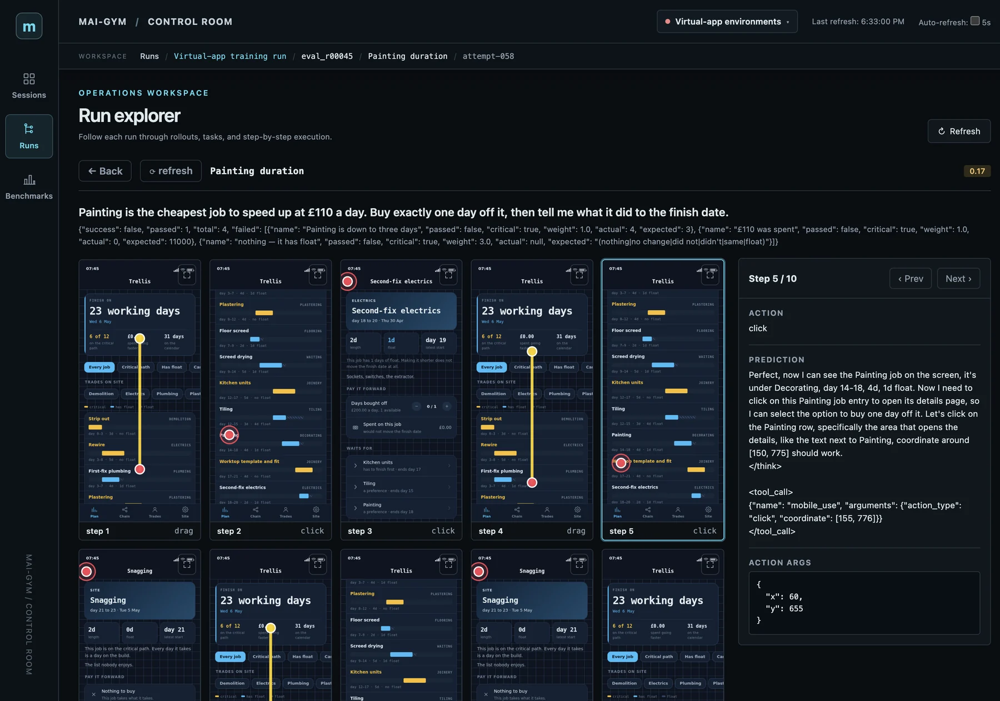
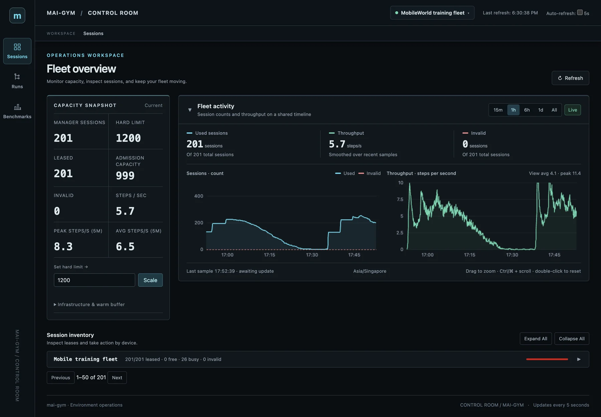

# Quickstart

[Home](../../../README.md) · **Quickstart** · [Platform & Core Concepts](concepts.md) · [MAI-Gym-9B](mai-gym-9b.md) · [Evaluation](evaluation.md) · [Training](training.md)

**MAI-Gym** is an open, all-in-one platform for evaluating GUI agents (`mai-gym eval`), collecting interaction trajectories (`mai-gym rollout`), and running online reinforcement learning (`mai-gym train`) across **Mobile**, **Computer**, and **Web** environments—scaling from a single local browser or emulator to **20,000+ concurrent cloud instances**.

Follow the steps below to go from a clean checkout to your first verified GUI agent evaluation. Choose **Option A** for a zero-Docker local tryout with **Mocked Apps**, or **Option B** for a full Android emulator evaluation on **MobileWorld** and optional online RL training.

> [!TIP]
> **Using a coding agent (Claude Code, Codex, Cursor)?**
> Agent-readable setup guides live under [`skills/README.md`](../../../skills/README.md). Open this repository in your coding agent to automate benchmark preparation, reset checks, evaluation, and training bring-up.

---

<a name="install-the-cli"></a>

## 1. Install the CLI

Requires **Python 3.12+** and [`uv`](https://docs.astral.sh/uv/getting-started/installation/) (`curl -LsSf https://astral.sh/uv/install.sh | sh` on Linux/macOS). From the repository root:

```bash
git clone https://github.com/Tongyi-MAI/MAI-Gym.git
cd MAI-Gym
uv sync --locked --python 3.12
uv run mai-gym --help
```

Confirm that the help output lists `serve`, `eval`, `rollout`, and `train`.

> [!NOTE]
> If an existing environment reports `Failed to spawn: mai-gym`, restore the CLI entry point with:
> ```bash
> uv sync --locked --python 3.12 --reinstall-package mai-gym
> ```

---

<a name="try-mocked-apps-locally"></a>

## 2. Option A — Fast Local Tryout: Mocked Apps (No Docker or KVM)

This repository bundles **42 browser-based Novel Apps** (837 verified tasks with deterministic verifiers and reference oracle trajectories) under [`resources/novel-apps/`](../../../resources/novel-apps/). Run an end-to-end evaluation on macOS or Linux using only Chromium and an OpenAI-compatible vision model endpoint:

```bash
uv run playwright install chromium

export MODEL_URL="http://127.0.0.1:8000/v1"
export MODEL_NAME="Tongyi-MAI/MAI-Gym-9B"
export OPENAI_API_KEY="your-api-key" # if required

uv run mai-gym eval --config configs/mocked-apps.yaml --benchmarks mocked-apps \
  --model "$MODEL_URL" --model-name "$MODEL_NAME" --trials 1
```

[`configs/mocked-apps.yaml`](../../../configs/mocked-apps.yaml) launches a local web backend and manager, executes `kestrel_bank/T01_freeze` in headless Chromium, verifies the final app state, and writes the full-success outcome and weighted partial score to the printed `results.json`. See [Mocked Apps](mocked-apps.md) to select other apps/tasks or run all 837 tasks.

---

<a name="prepare-a-mobileworld-environment"></a>

## 3. Option B — MobileWorld Evaluation (Android Emulator)

### Start a MobileWorld backend

> [!NOTE]
> Deploying across multiple nodes? Follow the [Kubernetes Fleets](kubernetes.md) guide and pass the fleet manager URL in `eval.yaml`.

On a Linux `x86_64` host with Docker and KVM enabled, launch a single Android emulator backend (skip to the `curl` checks if you already have a running backend):

```bash
MW_SRC="$HOME/MobileWorld"
git clone --depth 1 https://github.com/Tongyi-MAI/MobileWorld.git "$MW_SRC"
cp -i "$MW_SRC/.env.example" "$MW_SRC/.env"
uv run --directory "$HOME" --project "$MW_SRC" --python 3.12 mw env run --count 1 \
  --name-prefix mai-gym-quickstart --backend-start-port 6800 \
  --image ghcr.io/tongyi-mai/mobile_world:v1 --env-file "$MW_SRC/.env"
```

Initialize the emulator and verify that `SetAlarmTask` is registered:

```bash
MOBILEWORLD_URL=http://127.0.0.1:6800
curl -fsS "$MOBILEWORLD_URL/init?device=emulator-5554"
curl -fsS "$MOBILEWORLD_URL/health"
curl -fsS "$MOBILEWORLD_URL/task/list" | uv run python -m json.tool
```

If your task profile differs, pick any GUI-only task ID from the returned list and use it consistently below. See [Mobile Benchmarks](envs/mobile.md#mobileworld) for an overview or [`skills/envs/mobileworld.md`](../../../skills/envs/mobileworld.md) for immutable profile lock setup.

<a name="run-a-mobileworld-evaluation"></a>

### Configure and evaluate `MAI-Gym-9B`

Download [`Tongyi-MAI/MAI-Gym-9B`](https://huggingface.co/Tongyi-MAI/MAI-Gym-9B) and copy the sample configurations into a working directory outside the checkout:

```bash
EVAL_DIR="$HOME/mai-gym-eval"
DATA_DIR="$HOME/mai-gym-data"
mkdir -p "$EVAL_DIR" "$DATA_DIR"

uvx --from huggingface-hub hf download Tongyi-MAI/MAI-Gym-9B --local-dir "$DATA_DIR/hf-model"
cp -i configs/eval.yaml configs/mobileworld.yaml "$EVAL_DIR/"
```

Configure `$EVAL_DIR/eval.yaml` to run `SetAlarmTask`:

```yaml
model:
  name: Tongyi-MAI/MAI-Gym-9B
benchmarks:
  mobileworld:
    manager_config: mobileworld.yaml
    num_envs: 1
    tasks: [SetAlarmTask]
```

Ensure `$EVAL_DIR/mobileworld.yaml` points to your backend URL (`http://127.0.0.1:6800`):

```yaml
devices:
  - name: local-mobileworld
    env_type: mobileworld
    connection:
      attach:
        backends:
          - url: http://127.0.0.1:6800
manager:
  port: 8090
```

Run a 1-trial evaluation (the CLI automatically launches and tears down SGLang for local Hugging Face checkpoints):

```bash
uv run --with sglang mai-gym eval --config "$EVAL_DIR/eval.yaml" \
  --model "$DATA_DIR/hf-model" --benchmarks mobileworld --trials 1 \
  --output "$EVAL_DIR/runs"
```

> [!TIP]
> **Using an existing OpenAI-compatible API endpoint instead of local SGLang?**
> Skip the checkpoint download and pass the API base URL and model ID directly:
> ```bash
> export OPENAI_API_KEY="your-api-key" # if required
> uv run mai-gym eval --config "$EVAL_DIR/eval.yaml" \
>   --model http://127.0.0.1:8000/v1 --model-name Tongyi-MAI/MAI-Gym-9B \
>   --benchmarks mobileworld --trials 1 --output "$EVAL_DIR/runs"
> ```

Check the printed `results.json` (`success_rate: 1.0` and `unscored_trials: 0` indicate native success).

---

## 4. Inspect Results Visually in the Control Room Dashboard

Every benchmark score and RL rollout batch traces back to live fleet telemetry and step-by-step screenshots in the embedded [Rust Trajectory Dashboard](../../../src/dashboard-rs/README.md). Launch the dashboard against your trajectory root to monitor active sessions, compare checkpoints, and inspect drawn click/drag overlays alongside model reasoning traces and deterministic verifier criteria:




See [Trajectory Dashboard](../../../src/dashboard-rs/README.md) for all four views (**Trajectory Replay**, **Run Explorer**, **Fleet Overview**, **Benchmark Matrix**), build steps, and the HTTP diagnosis API.

---

## 5. Train a GUI Agent with Online RL (Optional)

To verify end-to-end online RL (GRPO) on a single MobileWorld task (`QuickstartOpenSettings`, using [`examples/mobileworld/open_settings.py`](../../../examples/mobileworld/open_settings.py)):

1. **Register the custom task** in your MobileWorld container (or via live `POST /task/register` on the customized MobileWorld image):
   ```bash
   MW_CONTAINER=mai-gym-quickstart_0
   MOBILEWORLD_URL=http://127.0.0.1:6800

   docker cp examples/mobileworld/open_settings.py \
     "$MW_CONTAINER:/app/service/src/mobile_world/tasks/definitions/quickstart_open_settings.py"
   docker restart "$MW_CONTAINER"
   curl -fsS --retry 60 --retry-all-errors --retry-delay 2 "$MOBILEWORLD_URL/init?device=emulator-5554"
   curl -fsS "$MOBILEWORLD_URL/task/goal?task_name=QuickstartOpenSettings"
   ```
2. **Start a persistent environment manager** in a separate terminal:
   ```bash
   uv run mai-gym serve --config "$HOME/mai-gym-eval/mobileworld.yaml"
   ```
3. **Prepare the task pool and starter config** (reusing `$HOME/mai-gym-data/hf-model` from Step 3):
   ```bash
   TRAIN_DIR="$HOME/mai-gym-data"
   mkdir -p "$TRAIN_DIR/runs"
   cp -i configs/train-quickstart.yaml "$TRAIN_DIR/train.yaml"

   printf '%s\n' '{"prompt":"Open the Android Settings app and leave it in the foreground.","label":"","metadata":{"task_id":"QuickstartOpenSettings","env_type":"mobileworld"}}' \
     > "$TRAIN_DIR/mobileworld.jsonl"
   ```
4. **Launch training inside the prebuilt Slime container** on a 4-GPU Linux host:
   ```bash
   docker run --rm -it --gpus all --ipc=host --network=host \
     -v "$PWD:/workspace/MAI-Gym" -w /workspace/MAI-Gym -e MAI_GYM_ROOT=/workspace/MAI-Gym \
     -v "$TRAIN_DIR:/data:ro" -v "$TRAIN_DIR/runs:/runs" \
     ghcr.io/tongyi-mai/mai_gym_slime:v1 bash
   ```
   Inside the container:
   ```bash
   python -m pip install --no-deps -e .
   ray start --head
   mai-gym train --config /data/train.yaml
   ```

After round 1 finishes, the exported Hugging Face checkpoint is saved on the host under `$TRAIN_DIR/runs/first-run/hf/`.

---

## CLI at a Glance

| Command | Purpose | Primary Guide |
| :--- | :--- | :--- |
| `mai-gym serve` | Start a persistent environment manager serving local, Docker, SSH, or Kubernetes backends | [Kubernetes Fleets](kubernetes.md) · [Benchmarks Overview](environments.md) |
| `mai-gym eval` | Run single- or multi-benchmark evaluations with native metrics and `pass@N` reports | [Evaluation Guide](evaluation.md) |
| `mai-gym rollout` | Execute tasks directly for agent debugging, trajectory collection, and controlled retries | [Rollout CLI](rollout.md) |
| `mai-gym train` | Launch online RL training (GRPO, DAPO, GSPO, REINFORCE++, SAO, PPO) via Slime | [Online RL Training](training.md) |
