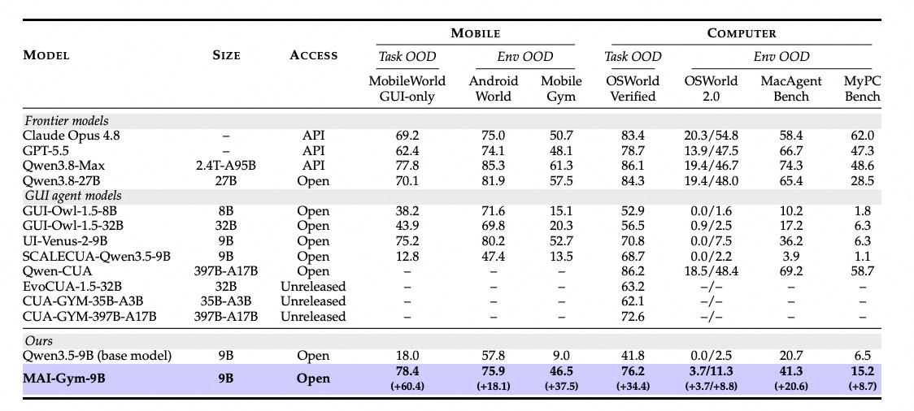

# MAI-Gym-9B

[Home](../../../README.md) · [Quickstart](index.md) · [Platform & Core Concepts](concepts.md) · **MAI-Gym-9B** · [Evaluation](evaluation.md) · [Training](training.md)

**MAI-Gym-9B** is an open 9B-parameter GUI agent trained end to end with MAI-Gym. Initialized from **Qwen3.5-9B** with a mixed mobile–computer SFT warm-up followed by a single joint online reinforcement learning run (**GRPO**) on synthesized MobileWorld and OSWorld tasks, MAI-Gym-9B achieves state-of-the-art performance among open GUI agents under 10B parameters across mobile and desktop benchmarks.

- **Hugging Face Checkpoint:** [`Tongyi-MAI/MAI-Gym-9B`](https://huggingface.co/Tongyi-MAI/MAI-Gym-9B)
- **Technical Report:** [`arXiv:2610.20939`](https://arxiv.org/abs/2610.20939)
- **Starter RL Config:** [`configs/mai-gym-9b.yaml`](../../../configs/mai-gym-9b.yaml)

---

## Benchmark Performance

All results below report native benchmark metrics (%) from **Section 4** of the [technical report](https://arxiv.org/abs/2610.20939), evaluated through the shared MAI-Gym harness (`temperature=0.0`). Gains show absolute percentage-point improvements over the base **Qwen3.5-9B** model.

<p align="center">
  
</p>

| Domain | Generalization | Benchmark | Qwen3.5-9B (Base) | **MAI-Gym-9B** | Gain |
| :--- | :--- | :--- | ---: | ---: | ---: |
| **Mobile** | Task OOD | MobileWorld (GUI-only) | 18.0 | **78.4** | **+60.4** |
| **Mobile** | Env OOD | AndroidWorld | 57.8 | **75.9** | **+18.1** |
| **Mobile** | Env OOD | MobileGym *(partial)* | 9.0 | **46.5** | **+37.5** |
| **Computer** | Task OOD | OSWorld-Verified | 41.8 | **76.2** | **+34.4** |
| **Computer** | Env OOD | OSWorld 2.0 *(binary / partial)* | 0.0 / 2.5 | **3.7 / 11.3** | **+3.7 / +8.8** |
| **Computer** | Env OOD | MacAgentBench | 20.7 | **41.3** | **+20.6** |
| **Computer** | Env OOD | MyPCBench | 6.5 | **15.2** | **+8.7** |

---

## Key Empirical Highlights

- **Single Joint Policy Across Mobile & Computer:** A single online RL run across mobile and desktop environments generalizes strongly not only to unseen tasks (*Task OOD*: **78.4%** on MobileWorld, **76.2%** on OSWorld-Verified), but also to unseen operating systems and benchmark suites (*Env OOD*: AndroidWorld, MobileGym, OSWorld 2.0, MacAgentBench, and MyPCBench).
- **Clone-to-Real Transfer (Mocked Apps → Physical Phone):** Training with online RL inside the resettable Railway12306 **Real-World Clone** transfers directly to the real production Railway12306 app on a physical smartphone, raising task success from **28.8% → 48.1%** without live production side effects during training.
- **Novel-App Adaptation (42 Novel Mocked Apps):** On previously unseen browser-based **Novel Apps** ([Mocked Apps gallery](https://tongyi-mai.github.io/MAI-Gym/#apps)), online RL adapts rapidly to unfamiliar layouts and workflows from verifier reward alone.

> [!NOTE]
> For complete frontier & open-model baseline comparisons, SFT-vs-RL ablations, infrastructure scaling up to 20,000 concurrent environments, joint RL vs. model merging, and task-scaling curves, see **Section 4** of the [technical report](https://arxiv.org/abs/2610.20939).

---

## Running MAI-Gym-9B

### Download and Evaluate Locally (Auto-Served SGLang)

Download the checkpoint from Hugging Face and let `mai-gym eval` launch and tear down SGLang automatically:

```bash
uvx --from huggingface-hub hf download Tongyi-MAI/MAI-Gym-9B --local-dir "$HOME/mai-gym-data/hf-model"

uv run --with sglang mai-gym eval --config "$HOME/mai-gym-eval/eval.yaml" \
  --model "$HOME/mai-gym-data/hf-model" --benchmarks mobileworld --trials 1
```

### Evaluate Against an OpenAI-Compatible Endpoint

If `Tongyi-MAI/MAI-Gym-9B` is already served (e.g., via SGLang or vLLM):

```bash
uv run mai-gym eval --config "$HOME/mai-gym-eval/eval.yaml" \
  --model http://127.0.0.1:8000/v1 --model-name Tongyi-MAI/MAI-Gym-9B \
  --benchmarks mobileworld osworld-verified --trials 1
```

### Training Reference

Use [`configs/mai-gym-9b.yaml`](../../../configs/mai-gym-9b.yaml) as a starting point for joint mobile and computer GRPO training. The [Online RL Training guide](training.md#prerequisites--presets) explains how to prepare task pools and run the preset with the prebuilt Slime image.

---

## Next Steps

- Run your first verified trial in minutes: [Quickstart](index.md)
- Configure all 10 benchmarks and native metrics: [Evaluation Guide](evaluation.md)
- Explore Mocked Apps: [Mocked Apps](mocked-apps.md)
- Replay model predictions and verifier outcomes: [Trajectory Dashboard](../../../src/dashboard-rs/README.md)
